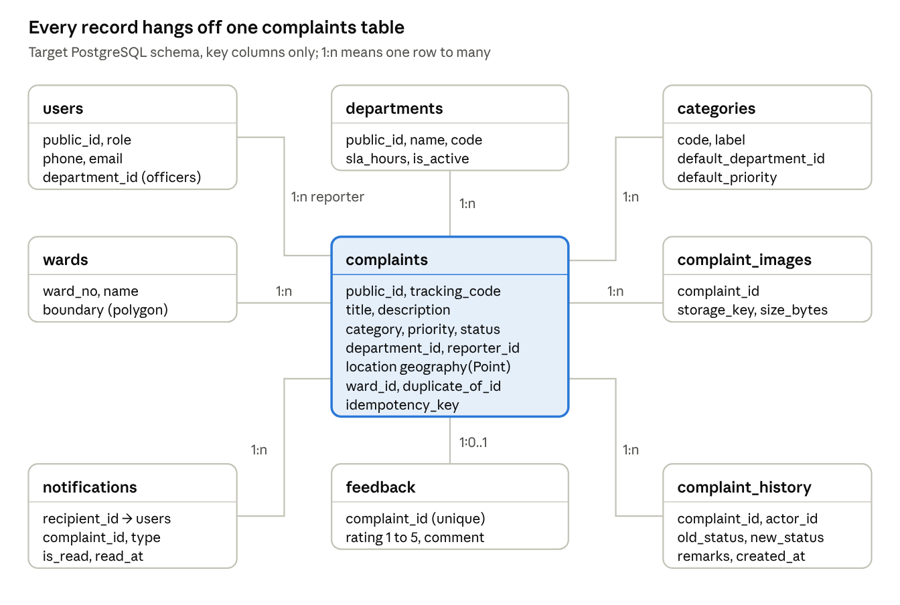

# CIVIC — Database Design

> Exported from the live Claude Doc on 2026-11-06: https://claude.ai/artifact/FDT4K9Npcica2nUrFDkpA1. Edit there, then re-export.

Nov 6, 2026 · @Sujit

## Overview

The target database is PostgreSQL with the PostGIS extension, owned by the CivicSetu Django backend. Today there is no server database: the prototype keeps everything in browser localStorage, and the UI imitates MongoDB geospatial queries.

|  | Today (prototype) | Target |
| --- | --- | --- |
| System of record | Browser localStorage, per device | PostgreSQL 15 or later, managed, Indian region |
| Geospatial | MongoDB-style `$near` and `$geoWithin` simulated in TypeScript | PostGIS `geography` columns with GiST indexes |
| Photos | Data URLs inside complaint JSON | Object storage; database keeps the key and metadata |
| Schema owner | None | Django models and migrations |
| Device storage | Everything | Session, draft, offline queue, guest codes only |

**Why PostgreSQL, not MongoDB.** The Django backend already runs on PostgreSQL. The data is relational: complaints belong to users, departments, categories and wards, and carry history, images, notifications and feedback. PostGIS gives the same nearby search as MongoDB's 2dsphere index. If the team later chooses MongoDB, the design maps across: each table below becomes a collection, and `location` becomes a GeoJSON Point with a `2dsphere` index.

## Entity relationship diagram

Complaints sit at the centre: each belongs to one department, category and ward, may have a reporter, and owns its images, history, notifications and at most one feedback.



Not drawn, to keep the picture readable: `users` → `notifications` (recipient), `users` → `complaint_history` (actor), `users` → `departments` (officers), `complaints` → `complaints` (duplicate of), and the sign-in tables `otp_challenges`, `webauthn_credentials` and `push_devices`, each linked to `users`.

## Tables and fields

Twelve tables: nine for the domain and three for sign-in support. Every table has a bigint primary key `id` for joins and, where clients see it, a `public_id` UUID that the API exposes instead.

**complaints**

| Column | Type | Constraints | Notes |
| --- | --- | --- | --- |
| `id` | bigint | PK, identity | Internal only |
| `public_id` | uuid | unique, not null | Used in API URLs |
| `tracking_code` | varchar(19) | unique, not null | `CMP-YYYYMMDD-XXXXXX` |
| `title` | varchar(200) | not null |  |
| `description` | text | not null |  |
| `category_code` | varchar(32) | FK → categories |  |
| `priority` | enum | `LOW`, `MEDIUM`, `HIGH`, `CRITICAL` | Defaults from the category |
| `status` | enum | `PENDING`, `ROUTED`, `ASSIGNED`, `IN_PROGRESS`, `RESOLVED`, `CLOSED` |  |
| `department_id` | bigint | FK → departments, not null | Set from category on create |
| `reporter_id` | bigint | FK → users, null for guests |  |
| `is_guest_report` | boolean | default false |  |
| `location` | geography(Point, 4326) | not null | Longitude, latitude |
| `location_address` | varchar(255) |  | Street address |
| `locality`, `city`, `landmark` | varchar(120) |  | Public tracking shows locality and city only |
| `ward_id` | bigint | FK → wards | Filled by point-in-polygon on save |
| `assigned_authority_id` | bigint | FK → users | Officer handling it |
| `report_count` | integer | default 1 | Raised when duplicates merge |
| `duplicate_of_id` | bigint | FK → complaints | Set on merged duplicates |
| `resolution_notes` | text |  |  |
| `idempotency_key` | uuid | unique, null | From the client's offline queue |
| `created_at`, `updated_at` | timestamptz | not null |  |
| `resolved_at`, `closed_at` | timestamptz |  |  |

**users**

| Column | Type | Constraints | Notes |
| --- | --- | --- | --- |
| `id`, `public_id` | bigint, uuid | PK, unique |  |
| `phone` | varchar(15) | unique, null | E.164, for OTP sign-in |
| `email` | varchar(254) | unique, null | Officers and email sign-in |
| `password` | varchar(128) |  | Django password hash; empty for OTP-only citizens |
| `full_name` | varchar(120) | not null |  |
| `role` | enum | `CITIZEN`, `AUTHORITY`, `ADMIN` |  |
| `department_id` | bigint | FK → departments | Officers only |
| `designation`, `badge_number` | varchar(80) |  | Officers only |
| `address`, `bio`, `profile_image` | text / varchar |  | Profile fields Django already exposes |
| `settings` | jsonb | default `{}` | Dark mode, notifications on, language |
| `status` | enum | `ACTIVE`, `SUSPENDED` |  |
| `created_at`, `last_login_at` | timestamptz |  |  |

**Other tables**

| Table | Key columns | Purpose |
| --- | --- | --- |
| `departments` | `public_id`, `name`, `code`, `sla_hours`, `is_active` | Municipal wings that own complaints; 9 in today's routing table |
| `categories` | `code` (PK), `label`, `default_department_id`, `default_priority` | The 9 categories and their routing; replaces the hard-coded switch in `api.ts` |
| `wards` | `ward_no`, `name`, `boundary geography(Polygon)` | Ward lookup for maps and reports |
| `complaint_images` | `public_id`, `complaint_id`, `storage_key`, `content_type`, `size_bytes`, `caption`, `uploaded_at` | Photos in object storage |
| `complaint_history` | `public_id`, `complaint_id`, `actor_id`, `action`, `old_status`, `new_status`, `remarks`, `created_at` | Timeline; append-only |
| `notifications` | `public_id`, `recipient_id`, `complaint_id`, `notification_type`, `title`, `message`, `is_read`, `read_at`, `created_at` | In-app list and push source |
| `feedback` | `public_id`, `complaint_id` (unique), `user_id`, `rating` (1 to 5), `comment`, `created_at` | One rating per resolved complaint |
| `otp_challenges` | `phone`, `code_hash`, `expires_at`, `attempts`, `consumed_at` | Phone sign-in; codes stored hashed |
| `webauthn_credentials` | `user_id`, `credential_id`, `public_key`, `sign_count`, `device_name`, `last_used_at` | Passkey sign-in |
| `push_devices` | `user_id`, `token`, `platform`, `created_at` | FCM and Web Push targets |

Django's JWT refresh-token blacklist adds its own two tables, managed by the library.

## Indexes

Eleven indexes cover every query the app makes. The spatial index on `complaints.location` is the PostgreSQL equivalent of the MongoDB `2dsphere` index the prototype imitates.

| Table | Index | Type | Serves |
| --- | --- | --- | --- |
| complaints | `location` | GiST (PostGIS) | Nearby search within a radius, nearest first |
| complaints | `tracking_code` | Unique B-tree | Public tracking lookup |
| complaints | `public_id` | Unique B-tree | Detail and timeline URLs |
| complaints | `idempotency_key` | Unique B-tree, partial (not null) | Duplicate-free retries from the offline queue |
| complaints | `(reporter_id, created_at DESC)` | B-tree | My Grievances list, newest first |
| complaints | `(department_id, status, created_at DESC)` | B-tree | Officer queue filtered by status |
| complaints | `(status, created_at)` partial where status not in (RESOLVED, CLOSED) | B-tree | Overdue and SLA reports |
| complaints | `(category_code, ward_id)` | B-tree | Reports by category and ward |
| wards | `boundary` | GiST (PostGIS) | Point-in-polygon ward lookup on save |
| complaint\_history | `(complaint_id, created_at)` | B-tree | Timeline in order |
| notifications | `(recipient_id, is_read, created_at DESC)` | B-tree | Notification list and unread count |

`users.phone`, `users.email`, `feedback.complaint_id` and every `public_id` also carry unique indexes from their constraints.

**MongoDB equivalent.** If a document store is chosen, create `{ "location": "2dsphere" }` on `complaints`, with `location` stored as `{ type: "Point", coordinates: [lng, lat] }`, plus unique indexes on `tracking_code` and `idempotency_key`.

## Sample record and common queries

The sample is the prototype's first seed complaint, shown as a target row. The queries are the six the app runs most.

**Sample complaint**

```json
{
  "public_id": "5d0c6a8e-3f1b-4c2a-9a77-1e2f3b4c5d6e",
  "tracking_code": "CMP-20261001-K8P9M1",
  "title": "Deep Pothole at Main Market Intersection, Gunupur",
  "category_code": "ROADS",
  "priority": "HIGH",
  "status": "IN_PROGRESS",
  "department": "Public Works Department (PWD)",
  "location": "SRID=4326;POINT(83.8166 19.0805)",
  "location_address": "Main Market Road, Old Town, Gunupur",
  "locality": "Old Town",
  "city": "Gunupur, Rayagada",
  "landmark": "Near SBI Branch",
  "report_count": 3,
  "is_guest_report": false
}
```

**My Grievances** (citizen's own, newest first)

```sql
SELECT public_id, tracking_code, title, status, priority, created_at
FROM complaints
WHERE reporter_id = :user_id
ORDER BY created_at DESC
LIMIT 20 OFFSET :offset;
```

**Officer queue**

```sql
SELECT public_id, tracking_code, title, status, priority, locality, created_at
FROM complaints
WHERE department_id = :dept_id
  AND status IN ('PENDING', 'ROUTED', 'ASSIGNED', 'IN_PROGRESS')
ORDER BY priority DESC, created_at;
```

**Public tracking** (no personal data selected)

```sql
SELECT c.tracking_code, c.title, c.category_code, c.priority, d.name AS department,
       c.status, c.locality, c.city, c.report_count, c.created_at, c.updated_at
FROM complaints c JOIN departments d ON d.id = c.department_id
WHERE c.tracking_code = upper(trim(:code));
```

**Nearby complaints** (default radius 3,000 m)

```sql
SELECT tracking_code, title, status, category_code, locality,
       round(ST_Distance(location, ST_MakePoint(:lng, :lat)::geography)) AS distance_m
FROM complaints
WHERE ST_DWithin(location, ST_MakePoint(:lng, :lat)::geography, :radius_m)
ORDER BY distance_m
LIMIT 100;
```

**Status change** (one transaction)

```sql
BEGIN;
UPDATE complaints SET status = :new_status, updated_at = now(),
       resolved_at = CASE WHEN :new_status = 'RESOLVED' THEN now() ELSE resolved_at END
WHERE id = :id AND department_id = :officer_dept_id;
INSERT INTO complaint_history (public_id, complaint_id, actor_id, action, old_status, new_status, remarks, created_at)
VALUES (gen_random_uuid(), :id, :officer_id, 'STATUS_CHANGE', :old_status, :new_status, :remarks, now());
INSERT INTO notifications (public_id, recipient_id, complaint_id, notification_type, title, message, is_read, created_at)
SELECT gen_random_uuid(), reporter_id, id, 'STATUS_CHANGE', :title, :message, false, now()
FROM complaints WHERE id = :id AND reporter_id IS NOT NULL;
COMMIT;
```

**Monthly department report**

```sql
SELECT d.name,
       count(*) AS received,
       percentile_cont(0.5) WITHIN GROUP (ORDER BY c.resolved_at - c.created_at) AS median_time_to_resolve,
       avg(f.rating) AS avg_rating
FROM complaints c
JOIN departments d ON d.id = c.department_id
LEFT JOIN feedback f ON f.complaint_id = c.id
WHERE c.created_at >= date_trunc('month', now()) - interval '1 month'
  AND c.created_at <  date_trunc('month', now())
GROUP BY d.name
ORDER BY received DESC;
```

In production Django's ORM generates these; the SQL shows what each query must do and which index serves it.

## Client-side storage and offline queue

The web app uses 11 localStorage keys today; in the target 7 remain, because complaints, notifications, tokens and passkeys move to the server or to safer storage.

**Web (localStorage)**

| Key | Holds | Written by | Target |
| --- | --- | --- | --- |
| `civic_civicsetu_complaints_db` | All complaints (mock database, seeded with 4) | `CivicSetuApiAdapter` | Remove |
| `civic_civicsetu_notifs_db` | All notifications (mock) | `CivicSetuApiAdapter` | Remove |
| `civic_secure_tokens` | Access and refresh tokens | `storage` | Remove; use httpOnly cookies or memory |
| `civic_registered_passkeys` | Last 10 passkey records | `storage` | Remove; the server stores credentials |
| `civic_current_user` | Signed-in user profile | `storage` | Keep as a cache, non-sensitive fields only |
| `civic_report_draft` | One unsent report form | `storage` | Keep |
| `civic_offline_sync_queue` | `OfflineQueuedComplaint[]` | `offlineSyncService` | Keep; add `idempotencyKey` and `state` per item |
| `civic_guest_tracking_codes` | Last 10 codes filed on this device | `storage` | Keep |
| `civic_last_known_location` | Last location fix | `geolocationUtil` | Keep |
| `civic_dark_mode` | Theme choice | Store | Keep |
| `civic_last_website_sync` | Time of last manual sync | Store | Keep |

**Offline queue item (target)**

```ts
interface OfflineQueuedComplaint {
  queueId: string;              // local id
  idempotencyKey: string;       // uuid v4, sent as Idempotency-Key
  input: CreateComplaintInput;  // photo kept as a Blob in IndexedDB, not a data URL
  queuedAt: string;
  userId?: string;
  state: 'PENDING' | 'FAILED' | 'UNKNOWN';
  retryCount: number;           // stop automatic retries at 5
  lastAttemptAt?: string;
  lastError?: string;
}
```

Today's item also carries a locally generated `trackingCode`; the target drops it, because only the server issues codes. Photos should move from data URLs in localStorage (about 5 MB total quota in most browsers) to IndexedDB.

**Android native mode**

- Expo SecureStore keys `civicsetu.auth.tokens` and `civicsetu.auth.user` hold the session.
- SQLite database `civicsetu-drafts.db`, table `complaint_drafts`: `local_id` (PK), `owner_id`, `payload` (JSON), `state` (PENDING, FAILED, UNKNOWN, SYNCED), `last_error`, `updated_at`, `server_public_id`, `server_tracking_code`; index `idx_drafts_owner` on `owner_id`.
- Every query is filtered by `owner_id`, so a second account on the same phone never sees the first account's drafts.

## Data lifecycle, retention, backup and migration

Complaints are a public record and are kept; personal data is kept only as long as needed and removed on request. Retention periods below are proposals for the municipality and its legal adviser to confirm under the DPDP Act, 2023.

**Retention (proposed)**

| Data | Keep for | Then |
| --- | --- | --- |
| Complaint record and history | 5 years after closure | Archive; reporter fields set to null |
| Complaint photos | 2 years after closure | Delete from object storage |
| Notifications | 1 year | Delete |
| Feedback | 5 years, with its complaint | Archive with complaint |
| OTP challenges | 24 hours | Delete |
| User account | Until the user deletes it, or 3 years inactive | Delete the user; keep complaints with `reporter_id` null |
| Device draft and queue | Until sent or deleted by the user | Removed on the device |

**Backup and recovery**

- Daily full backup plus continuous WAL archiving for point-in-time recovery over 14 days.
- Object storage versioning on photos, with a 30-day window for deleted versions.
- Backups encrypted and kept in a second Indian region.
- A restore test every quarter into a scratch database; target recovery point 15 minutes, recovery time 4 hours.

**Migration plan**

1. Enable PostGIS on the Django database (`CREATE EXTENSION postgis`).
2. Add `location geography(Point, 4326)` to complaints and backfill it from the existing latitude and longitude fields; then add the GiST index concurrently.
3. Add `idempotency_key` with a partial unique index; add `ward_id`, `report_count` and `duplicate_of_id` if missing.
4. Create `categories` and seed the 9 categories with the routing now hard-coded in `api.ts`.
5. Create `wards` and seed the ward polygons now hard-coded in `mongoGeospatial.ts`.
6. Create `otp_challenges`, `webauthn_credentials` and `push_devices` when those features ship.
7. Do not migrate prototype localStorage data; it is demo data only. Ship a one-time client cleanup that deletes the mock keys.

Each step is a separate Django migration that can run while the app is live: add columns as nullable, backfill, then add constraints.
