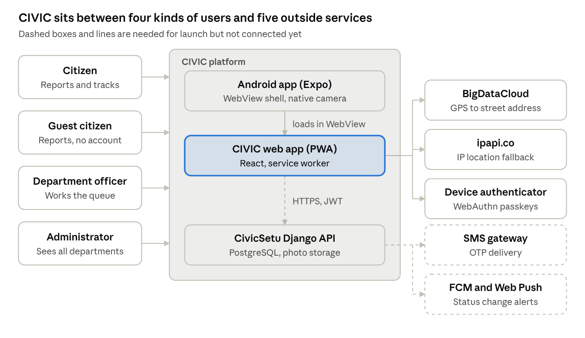

# CIVIC — High-Level Design (HLD)

> Exported from the live Claude Doc on 2026-11-06: https://claude.ai/artifact/YFghcsBAYBws2eqkiK8GiC. Edit there, then re-export.

Nov 6, 2026 · @Sujit

## Purpose and scope

This HLD names CIVIC's major modules, what each is responsible for, how data moves between them and which outside systems they depend on. It is the bridge between the product requirements and the code-level design.

**Covers:** the web app (PWA), the Express web server, the Android app in both modes, and the CivicSetu Django API as seen by these clients.

**Does not cover:** Django internals, which live in the sibling backend repository.

**Related documents:** layers, stack and deployment are in [CIVIC — System Architecture](SYSTEM_ARCHITECTURE.md); classes, functions and sequences are in [CIVIC — Low-Level Design (LLD)](LLD.md); tables and indexes are in [CIVIC — Database Design](DATABASE_DESIGN.md).

## System context

Four kinds of users reach one platform. The web app is the hub: the Android app loads it, and in the target it makes all calls to the Django API. Android native mode, an alternative build, calls Django directly.

The web app uses geocoding, IP location and the device authenticator directly. SMS and push are backend concerns: Django sends OTPs and push messages, the clients only receive them.

## Major modules

Twelve modules across four deployables. Each web module has one job and talks only to the module below it.

| Module | Code location | Responsibility | Depends on |
| --- | --- | --- | --- |
| App shell and navigation | `src/App.tsx`, `BottomNav`, `MobileDeviceFrame` | Picks the screen from `currentScreen`; frames the app as Android, iOS, full screen or website | Store |
| Screens | `src/screens/*` (11) | Login, Register, Home, Report, Success, My Grievances, Details, Track, Map, Notifications, Profile | Store, components |
| Shared components | `src/components/*` (18) | Buttons, inputs, cards, timeline, camera, image and location pickers, modals, banners, toasts | Utils |
| State store | `src/store/civicStore.tsx` | One React context holding user, screen, complaints, notifications, draft, online status, theme; exposes every action | Services |
| Auth module | `services/auth.ts`, `services/webAuthn.ts` | Phone OTP, officer login, passkey sign-in, register, refresh, guest session, logout | API client, storage |
| Complaint module | `services/complaints.ts`, `services/tracking.ts` | Create (or queue offline), list, details, officer status update, feedback, public tracking | API client, offline sync |
| Notification module | `services/notifications.ts` | List, mark read, mark all read | API client |
| Offline sync module | `services/offlineSync.ts`, `public/sw.js` | Queue reports offline; replay when online; cache the app shell | Storage, service worker |
| Geo module | `utils/geolocation.ts`, `services/mongoGeospatial.ts` | GPS with fallbacks, reverse geocoding, nearby and ward queries for the map | Browser geolocation, external geo APIs |
| API client | `services/api.ts` | Single entry point `apiRequest()`; today routes to the in-browser mock adapter | Backend (target) or localStorage (today) |
| Web server | `server.js` | Serves `dist/`, SPA fallback, `/api/geo/*`, `/healthz` | Node runtime |
| Android app | `mobile/` | WebView shell with native camera bridge (default), or native screens with SQLite drafts and SecureStore | Web app, Django API |

## High-level data flow

Complaint data is captured on the phone, owned by Django once saved, and read back by three audiences: the reporter, the department officer, and the public by tracking code.

**Path of one complaint**

1. **Capture.** The Report screen collects title, description, category, one photo and a location (GPS, pin or address). An unfinished form is saved as a draft on the device.
2. **Classify.** The client maps category to department and default priority (for example Roads & Pavements → PWD, High).
3. **Submit.** Online: sent to Django, which assigns the ID and tracking code. Offline: held in the device queue until the network returns.
4. **Work.** Officers read their department's queue and add status changes; each change appends a timeline entry and a notification.
5. **Read back.** The reporter sees the full record; the public sees a reduced record by tracking code; the map shows nearby complaints.
6. **Close.** After Resolved, the reporter can add one rating and comment.

**Where each kind of data lives**

| Data | Created by | Today | Target | Who can read it |
| --- | --- | --- | --- | --- |
| User profile and role | Sign-in or registration | localStorage `civic_current_user` | Django `users` table; client caches profile | The user; admins |
| Session tokens | Sign-in | localStorage `civic_secure_tokens` | httpOnly cookie (web), SecureStore (Android) | The client only |
| Complaint | Citizen or guest | localStorage `civic_civicsetu_complaints_db` | PostgreSQL `complaints` | Owner, the department, admins; public sees a reduced view |
| Photo | Citizen | Data URL inside the complaint record | Object storage, linked from `complaint_images` | Same as the complaint |
| Timeline entry | Server on each status change | Array inside the complaint | `complaint_history` rows | Same as the complaint |
| Notification | Server on each status change | localStorage `civic_civicsetu_notifs_db` | `notifications` table, plus push | Recipient only |
| Feedback | Reporter, after Resolved | Field on the complaint | `feedback` table | Owner, department, admins |
| Draft | Citizen | localStorage `civic_report_draft` | Same on web; SQLite on Android | Device only |
| Offline queue | Citizen, while offline | localStorage `civic_offline_sync_queue` | Same, with an idempotency key per item | Device only |
| Guest tracking codes | Guest reports | localStorage `civic_guest_tracking_codes` (last 10) | Same | Device only |

## External integrations

CIVIC calls four outside web services today, none needing an API key, and needs four more for launch.

| Integration | Status | Used by | Purpose | Failure behaviour |
| --- | --- | --- | --- | --- |
| CivicSetu Django API (`/api/v1`) | Needed for launch | All services | System of record, auth, notifications | Show error; offline reports stay queued |
| BigDataCloud reverse geocoding | In use | `utils/geolocation.ts` | Turn GPS coordinates into a readable address | 2 s timeout, then coordinates only |
| ipapi.co | In use | `utils/geolocation.ts` | Approximate location when GPS is denied or slow | Falls back to Gunupur town centre |
| Google Fonts | In use | `index.html` | Plus Jakarta Sans and Inter fonts | System fonts |
| Browser WebAuthn (`navigator.credentials`) | In use | `services/webAuthn.ts` | Face ID, fingerprint or Windows Hello sign-in | Phone OTP |
| SMS gateway | Needed for launch | Django | Deliver OTPs | Guest reporting still works |
| Firebase Cloud Messaging / Web Push | Needed for launch | Django, service worker | Push status changes to phones | In-app notification list |
| Google Play | Needed for launch | Android release | Distribute the app | Install the PWA from the browser |
| QR Server (api.qrserver.com) | In use | components/ShareModal.tsx | QR code image for sharing the app link; replace with a local QR library | Copy link and share sheet still work |

The seed data also loads four sample photos from Unsplash; these must not ship in production.

## Deployment overview

Four deployable units, each released on its own. The full topology diagram and environment table are in [CIVIC — System Architecture](SYSTEM_ARCHITECTURE.md).

| Unit | Built with | Runs on | Release trigger |
| --- | --- | --- | --- |
| Web app (static bundle) | `npm run build` → `dist/` | Served by the Express server | Any web change |
| Express web server | `server.js` | Google Cloud Run, port from `PORT` | Web release or server change |
| Android app | EAS Build (`preview` APK, `production` AAB) | Android phones via Google Play | Native shell change only; web changes reach the WebView without a store release |
| CivicSetu Django API | Sibling repository | HTTPS host to be chosen, with PostgreSQL | Backend release |

Because the Android app loads the live website, most fixes ship to Android users the moment the web app is deployed.

## Non-functional design decisions

Eight decisions shape how CIVIC meets its speed, offline, privacy and reach targets. Each has a cost worth knowing.

| Decision | Why | Trade-off |
| --- | --- | --- |
| Single-page app with screen state, no URL router | Feels like a native app; simple navigation in a WebView | No deep links or browser back per screen; a router is needed for shareable complaint URLs |
| One React context for all app state | Small app, one place to read state | Every update re-renders all consumers; split contexts if lists grow large |
| Category decides department and priority on the client, no AI | Instant routing; AI step was removed in v1 to cut latency | Wrong category means wrong department; the grievance cell must be able to reassign |
| Location with hard timeouts (GPS 1.8 s, geocode 2 s) and fallbacks | The form never hangs on a weak signal | Fallback location can be coarse; the citizen can still move the pin |
| Offline queue in the browser plus service worker sync | Reports survive dead zones | Needs a server idempotency key to avoid duplicates on retry |
| Android as a WebView shell, not a full native app | One codebase; web fixes reach Android without a store release | Camera and secure storage need a native bridge; WebView performance on low-end phones |
| Public tracking returns a reduced record | Lets anyone check status without exposing the reporter | Two serializers to keep in step (owner and public) |
| Photos sent as data URLs today, multipart files in the target | Simple in the prototype | Data URLs are about a third larger; the target sends files as multipart, as Django expects |
