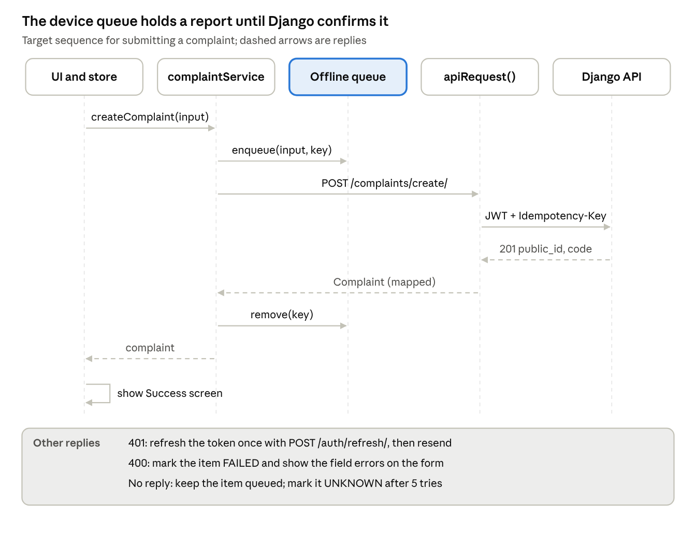

# CIVIC — Low-Level Design (LLD)

> Exported from the live Claude Doc on 2026-11-06: https://claude.ai/artifact/P6JwhMkn5yVWDf2ffPHaqe. Edit there, then re-export.

Nov 6, 2026 · @Sujit

## Code structure

The web app is about 10,900 lines of TypeScript in `src/`, layered as screens → store → services → API client. The Android app lives separately in `mobile/`.

```text
civic---powered-by-civicsetu/
├─ index.html                 PWA meta, fonts, #root
├─ server.js                  Express: dist/, /api/geo/*, /healthz
├─ vite.config.ts             React + Tailwind plugins, '@' alias, HMR switch
├─ public/
│  ├─ manifest.json           PWA manifest
│  └─ sw.js                   service worker (cache + background sync)
├─ src/
│  ├─ main.tsx                createRoot(<App/>)
│  ├─ App.tsx                 CivicProvider + MainNavigator (screen switch)
│  ├─ types/index.ts          all shared types
│  ├─ store/civicStore.tsx    CivicProvider, useCivic()
│  ├─ screens/                11 screens
│  ├─ components/             18 shared components
│  ├─ services/               api, auth, complaints, tracking, notifications,
│  │                          profile, offlineSync, webAuthn, mongoGeospatial
│  ├─ utils/                  storage, geolocation, formatters, haptics
│  ├─ theme/index.ts          LIGHT_THEME, DARK_THEME tokens
│  └─ serviceWorkerRegistration.ts
├─ mobile/                    Expo app (WebView shell + native mode)
└─ docs/                      build, API contract, offline, phase reports
```

**Dependency rule.** Screens and components read state and call actions only through `useCivic()`. Only services import `apiRequest`. Only `utils/`, the services and the store (for theme and last-sync time) touch `localStorage`. Nothing imports a screen except `App.tsx`.

## Screens and navigation

There is no URL router. `currentScreen` in the store picks one of 11 screens; `setCurrentScreen()` records the previous screen and `goBack()` returns to it (one level only).

| Screen | `ScreenTab` key | Reached from | Main store calls |
| --- | --- | --- | --- |
| HomeScreen | `home` | Bottom nav, default | `complaints`, `pendingOfflineCount`, `syncWithWebsite()` |
| ReportScreen | `report` | Bottom nav centre button, Home | `draft`, `saveDraft()`, `submitComplaint()` |
| SuccessScreen | `success` | After submit | `lastSubmittedComplaint`, `lastDuplicateMatch` |
| MyGrievancesScreen | `grievances` | Bottom nav | `complaints`, `refreshComplaints()`, `viewComplaintDetails()` |
| ComplaintDetailsScreen | `details` | Grievance card, notification | `selectedComplaint`, `submitFeedback()`, `updateAuthorityComplaintStatus()` |
| TrackScreen | `track` | Bottom nav | `trackComplaint(code)` |
| CivicMapScreen | `map` | No button opens it yet | `complaints` + `mongoGeoService` queries |
| NotificationsScreen | `notifications` | Bell icon | `notifications`, `markNotificationRead()`, `markAllNotificationsRead()` |
| ProfileScreen | `profile` | Bottom nav | `user`, `updateUserProfile()`, `toggleDarkMode()`, `logout()` |
| LoginScreen | `login` | Profile, Register | `loginWithPhoneOtp()`, `loginAuthority()`, `loginWithBiometrics()`, `startGuestSession()` |
| RegisterScreen | `register` | Profile | `register()` |

The bottom nav has five tabs: Home, Grievances (also lit on Details), Report, Track and Profile. `MobileDeviceFrame` wraps everything and switches between Android, iOS, full-screen and website frames (`deviceMode`).

**Change needed for the target:** add a router (for example React Router) with URLs such as `/track/:code` and `/complaints/:publicId`, so shared links and notifications can deep-link.

## Components and their props

18 components in `src/components/`. Most take plain props; the four banners and frames read the store directly through `useCivic()`.

| Component | Props | Behaviour |
| --- | --- | --- |
| `CivicButton` | `variant` (primary, secondary, environmental, outline, ghost, blue), `size` (md, lg), `isLoading`, `loadingText`, `icon`, `iconPosition`, `fullWidth`, plus all button attributes | Standard button with spinner state |
| `CivicTextInput` | `label`, `helperText`, `error`, `icon`, plus all input attributes; forwards ref | Labelled input with error text |
| `ComplaintCard` | `complaint`, `onClick` | Card with status chip and progress bar: Pending 20%, Routed/Assigned 50%, In Progress 80%, Resolved/Closed 100% |
| `ComplaintTimeline` | `timeline: TimelineEvent[]` | Vertical timeline; empty-state text if none |
| `StatusChip` | `status`, `size` (sm, md, lg), `showIcon` | Coloured badge per status |
| `NotificationCard` | `notification`, `onClick` | One notification row with read state |
| `ImagePicker` | `imageUrl?`, `onImageChange(url?)` | File input or camera; 8 MB limit; inside the Android WebView, posts `CIVICSETU_OPEN_CAMERA` and listens for the native result event |
| `CameraModal` | `onCapture(dataUrl)`, `onClose` | Browser camera via `getUserMedia`, with sample photos for demos |
| `LocationPickerModal` | `currentLocation?`, `onLocationSelected(location)`, `onClose` | GPS, preset Gunupur localities, manual address |
| `FeedbackModal` | `trackingCode`, `onSubmit(rating, comment?)`, `onClose` | 1–5 stars, default 5, optional comment |
| `BiometricAuthModal` | `isOpen`, `onClose`, `onSuccess(credential)` | WebAuthn passkey register and sign-in |
| `ShareModal` | `isOpen`, `onClose` | Share the app link by QR code, copy, or `navigator.share` |
| `EmptyState`, `LoadingState` | `title`, `description`, `actionText`, `onAction`, `icon`; `ErrorState` (same file): `message`, `onRetry`; `LoadingState`: `message` | Placeholders |
| `BottomNav` | none (store) | Five tabs; hidden on login and register |
| `MobileDeviceFrame` | `children` (store for `deviceMode`) | Phone frame or full-width website layout |
| `OfflineSyncBanner` | none (store) | Shows offline state and pending queue count |
| `PushNotificationToast` | none (store) | Shows `activePushToast`, auto-dismisses after 6 s |

## State store design

All app state lives in one React context, `CivicProvider` in `src/store/civicStore.tsx` (806 lines), read with `useCivic()`. Actions are `useCallback` functions that call a service, update state, and fire a haptic cue.

**State**

| Field | Type | Initial value | Persisted as |
| --- | --- | --- | --- |
| `user` | `User \| null` | from storage | `civic_current_user` |
| `currentScreen`, `previousScreen` | `ScreenTab` | `home`, `null` | not persisted |
| `deviceMode` | `android \| ios \| fullscreen \| website` | `android` | not persisted |
| `complaints` | `Complaint[]` | `[]`, loaded on mount | via the API layer |
| `selectedComplaint`, `lastSubmittedComplaint` | `Complaint \| null` | `null` | not persisted |
| `lastDuplicateMatch` | `DuplicateReportMatch \| null` | `null` | not persisted |
| `isLoadingComplaints`, `complaintsError` | `boolean`, `string \| null` | `false`, `null` | not persisted |
| `notifications` | `AppNotification[]` | `[]`, loaded on mount | via the API layer |
| `draft` | `ReportDraft \| null` | from storage | `civic_report_draft` |
| `isOnline`, `pendingOfflineCount` | `boolean`, `number` | `navigator.onLine`, queue length | queue in `civic_offline_sync_queue` |
| `isSyncingWithWebsite`, `lastWebsiteSync` | `boolean`, `string \| null` | `false`, from storage | `civic_last_website_sync` |
| `activePushToast` | `PushNotificationData \| null` | `null` | not persisted |
| `darkMode` | `boolean` | storage, then user setting, then `false` | `civic_dark_mode` |

Derived values: `isAuthenticated`, `isAuthority`, `isGuest`, `unreadCount`.

**Actions**

- Navigation: `setCurrentScreen`, `goBack`, `setDeviceMode`, `viewComplaintDetails`.
- Auth: `loginWithPhoneOtp`, `loginAuthority`, `loginWithBiometrics`, `login`, `register`, `startGuestSession`, `logout`, `updateUserProfile`.
- Complaints: `refreshComplaints`, `submitComplaint`, `trackComplaint`, `submitFeedback`, `updateAuthorityComplaintStatus`.
- Notifications: `markNotificationRead`, `markAllNotificationsRead`, `showPushToast`, `dismissPushToast`.
- Offline and sync: `syncOfflineIssues`, `syncWithWebsite`, `saveDraft`, `clearDraft`.
- Theme: `toggleDarkMode`, `setDarkMode`.
- Demo only: `simulateStatusChange` (moves a complaint to In Progress or Resolved and shows a toast); remove for production.

**Effects**

1. When `user` changes: reload complaints and notifications.
2. On mount: register the service worker; start `offlineSyncService.initAutoSync()` (on the `online` event, every 15 s, and once at start); listen for `online` and `offline` to update `isOnline`.
3. When `darkMode` changes: toggle the `dark` class and `data-theme` on `<html>` and save it.

**Known issue.** One context means any change, such as a toast, re-renders every consumer. Split it into session, complaints and UI contexts, or move to a small store such as Zustand, if lists grow.

## Services and utilities

Every service is a plain object of async functions that call `apiRequest(endpoint, init)`. Today `apiRequest` waits 30 ms and dispatches to `CivicSetuApiAdapter`; the target sends the same call to Django.

| Service | Functions | Mock route today | Target Django route |
| --- | --- | --- | --- |
| `authService` | `loginWithPhoneOtp`, `loginAuthority`, `loginWithBiometrics`, `login`, `register`, `refreshToken`, `startGuestSession`, `logout` | `/auth/phone-otp`, `/auth/authority-login`, `/auth/biometric`, `/auth/login`, `/auth/register`, `/auth/refresh` | `/auth/otp/verify/`, `/auth/login/`, `/auth/register/`, `/auth/refresh/`, `/auth/logout/` |
| `complaintService` | `createComplaint`, `getComplaints`, `getComplaintById`, `updateComplaintStatus`, `submitFeedback` | `/complaints`, `/complaints/update-status`, `/feedback` | `/complaints/create/`, `/complaints/`, `/complaints/{id}/`, `/complaints/{id}/status/`, `/complaints/{id}/feedback/` |
| `trackingService` | `trackComplaint(code)` | `/tracking/{code}` | `/complaints/track/{code}/` |
| `notificationService` | `getNotifications`, `markAsRead`, `markAllAsRead` | `/notifications`, `/notifications/{id}/read`, `/notifications/read-all` (unhandled) | `/notifications/`, `/notifications/{id}/mark-read/`, `/notifications/mark-all-read/` |
| `profileService` | `getProfile`, `updateProfile` | `/auth/me`, `/profile` (unhandled) | `/auth/me/`, `/users/profile/update/` |
| `offlineSyncService` | `isOnline`, `getQueue`, `enqueueComplaint`, `processQueue`, `initAutoSync` | localStorage only | Sends queued items to `/complaints/create/` |
| `webAuthn` | Passkey register and sign-in via `navigator.credentials` | Browser only | Needs server challenge and verification endpoints |
| `mongoGeoService` | `queryNear`, `queryCenterSphere`, `queryBox`, `generateAggregationPipeline` | Browser, over loaded complaints | `/complaints/nearby/` |

**Two mock routes are unhandled.** `markAllAsRead` calls `/notifications/read-all` and `updateProfile` calls `PUT /profile`, but the adapter has no branch for either, so both return `{}` and change nothing in storage.

**Utilities**

| Utility | Exports | Notes |
| --- | --- | --- |
| `utils/storage.ts` | `storage.saveTokens / getTokens / clearTokens`, user, draft, guest tracking codes (last 10), passkeys (last 10), `clearAll` | Wraps localStorage in try/catch |
| `utils/geolocation.ts` | `GUNUPUR_LOCATION`, `QUICK_LOCALITIES`, `geolocationUtil.getQuickLocation`, `reverseGeocode`, `getIpBasedLocation`, `findClosestLocality`, `calculateDistanceKm` | See algorithm below |
| `utils/formatters.ts` | `formatDate`, `formatTimeAgo`, `getGreeting`, `truncateText` | Display helpers |
| `utils/haptics.ts` | `haptics` (light, medium, success, error cues) | Audio and vibration feedback |
| `theme/index.ts` | `LIGHT_THEME`, `DARK_THEME`, `THEME`, `getTheme(darkMode)` | Colour tokens |

**`getQuickLocation()` algorithm**

1. Return the cached location if one is saved.
2. Start a 2 s safety timer that resolves with IP location, or Gunupur centre (19.0805, 83.8166).
3. Call `navigator.geolocation.getCurrentPosition` with high accuracy, 1.8 s timeout, 60 s maximum age.
4. On success, reverse-geocode with BigDataCloud (2 s timeout), cache and return. On error, fall back as in step 2.
5. Whichever path finishes first wins; the others are ignored.

## Type definitions and data contracts

All web types live in `src/types/index.ts` (191 lines). They are camelCase and differ from Django's snake\_case contract, so the target needs one mapping layer in the API client.

**Enumerations**

- `UserRole`: `citizen`, `authority`, `guest`.
- `ComplaintStatus`: `Pending` → `Routed` → `Assigned` → `In Progress` → `Resolved` → `Closed`.
- `ComplaintPriority`: `Low`, `Medium`, `High`, `Critical`.
- `CivicCategory` (9): Roads & Pavements, Garbage & Sanitation, Water Supply & Leakage, Street Lighting & Power, Sewage & Drainage, Parks & Public Greenery, Air & Environmental Noise, Public Safety & Hazards, Other Municipal Services.
- `AppNotification.type`: `status_change`, `assigned`, `resolved`, `duplicate_merged`, `system`.

**Core type**

```ts
interface Complaint {
  id: string;                 // server public_id in the target
  trackingCode: string;       // CMP-YYYYMMDD-XXXXXX
  title: string;
  description: string;
  category: CivicCategory;
  priority: ComplaintPriority;
  department: string;
  status: ComplaintStatus;
  location: LocationData;     // latitude, longitude, address, locality?, city?, landmark?
  imageUrl?: string;
  createdAt: string;          // ISO 8601
  updatedAt: string;
  citizenId?: string;
  citizenPhone?: string;
  isGuestReport: boolean;
  isOfflineQueued?: boolean;
  syncedAt?: string;
  reportCount: number;
  timeline: TimelineEvent[];
  aiAnalysis?: AIAnalysisResult;
  feedback?: { rating: number; comment?: string; submittedAt: string };
}
```

Other types: `User`, `AuthTokens`, `AuthResponse`, `LocationData`, `TimelineEvent`, `PublicTrackingResult`, `ReportDraft`, `CreateComplaintInput`, `FeedbackInput`, `DuplicateReportMatch`, `OfflineQueuedComplaint`, `OfflineSyncStatus`, `AIAnalysisResult` (unused in v1).

**Web ↔ Django field mapping** (Django side from `mobile/src/services/api.ts`)

| Web field | Django field | Conversion |
| --- | --- | --- |
| `id` | `public_id` | Rename |
| `trackingCode` | `tracking_code` | Rename |
| `location.latitude`, `location.longitude` | `latitude`, `longitude` | Django sends strings; parse to numbers |
| `location.address` | `location_address` | Rename |
| `imageUrl` | `images[0].image` | First image URL; upload as multipart `images` |
| `status`, `priority`, `category` | `status`, `priority`, `category` | Map display labels to Django enum codes |
| `department` | `department_public_id` on create; name on read | Look up from `/departments/` |
| `timeline` | `/complaints/{id}/timeline/` → history rows (`action`, `old_status`, `new_status`, `remarks`, `created_at`) | Separate call; map each row to a `TimelineEvent` |
| `createdAt`, `updatedAt` | `created_at`, `updated_at` | Rename |
| `user.name` | `full_name` | Rename |
| `tokens.accessToken`, `refreshToken` | `tokens.access`, `tokens.refresh` | Rename |
| `AppNotification.read` | `is_read` | Rename |
| `reportCount`, `isGuestReport`, `citizenPhone` | No Django field yet | Add to the backend or drop from the web type |

## Server endpoints

`server.js` (about 190 lines) is an Express 4 app that serves the production build and two demo geo endpoints over four hard-coded Gunupur complaints. It listens on `0.0.0.0:${PORT}`, default 3000.

**Middleware and routes, in order**

| Order | Route | Handler |
| --- | --- | --- |
| 1 | all | `express.json()` body parser |
| 2 | `GET /api/geo/complaints/near?lng=&lat=&maxDistance=` | Haversine distance to each of the 4 records; keep those within `maxDistance` (default 5,000 m); sort nearest first |
| 3 | `POST /api/geo/query` | Reads `query.location.$near` (or `location.geoJSON.$near`); same filter and sort; returns results with a fake `explain` plan. Without `$near`, returns all 4 records |
| 4 | static | `express.static('dist')` |
| 5 | `GET /healthz` | `200 OK`, plain text |
| 6 | `GET *` | SPA fallback: send `dist/index.html`, or 500 "Application build not found" if the build is missing |

Defaults when parameters are missing: `lng` 83.8166, `lat` 19.0805 (Main Market, Gunupur). Distance uses an Earth radius of 6,378,137 m.

**`GET /api/geo/complaints/near` response**

```json
{
  "ok": true,
  "query": { "location": { "$near": { "$geometry": { "type": "Point", "coordinates": [83.8166, 19.0805] }, "$maxDistance": 5000 } } },
  "indexUsed": "location.coordinates_2dsphere",
  "count": 4,
  "data": [ { "id": "cmp_seed_001", "trackingCode": "CMP-20261001-K8P9M1", "status": "In Progress", "distanceMeters": 0, "...": "..." } ]
}
```

**Notes for the target**

- The web app does not call these geo endpoints; the map uses the browser engine. Retire both once Django serves `/complaints/nearby/`.
- Keep `/healthz` and the SPA fallback; add security headers (for example with `helmet`) and gzip or brotli compression.
- Serve hashed assets with long cache headers and `index.html` with `no-cache`, so new releases load immediately.

## Sequence diagrams and error handling

Every submit writes to the device queue first and deletes from it only after Django confirms; every other error path leaves the report safe on the device.



Today's prototype differs in two places: `createComplaint` calls the queue only when offline, and `processQueue()` marks items synced without calling any server.

**Error handling rules**

| Situation | Where caught | What the user sees | What the code does |
| --- | --- | --- | --- |
| Form invalid (empty title or description) | `ReportScreen` | One message above Submit, for example "Please provide a short title for the issue." | Blocks submit |
| Offline at submit | `complaintService` | "Saved offline" banner with queue count | Queues; `OfflineSyncBanner` shows pending count |
| 400 validation from Django | API client | Field errors from `{field: [messages]}` | Marks queue item FAILED; keeps the draft |
| 401 expired token | API client | Nothing, if refresh works | Refreshes once and retries; on second 401, `logout()` and go to Login |
| 403 not allowed | API client | "You don't have access to this complaint" | No retry |
| 404 tracking code | `trackComplaint` | "No complaint found with tracking code …" | No retry |
| Timeout (15 s) or network error | API client | "Saved; we'll send it when you're back online" | Keeps queued; retries up to 5 times, then UNKNOWN |
| 5xx server error | API client | "CivicSetu is having trouble; try again shortly" | Keeps queued; retries with backoff |
| List fails to load | `refreshComplaints` | `ErrorState` with Retry; default text "Couldn't connect to CivicSetu." | Sets `complaintsError` |
| Storage full or blocked | `utils/storage.ts` | Nothing | Every read and write is wrapped in try/catch and fails quietly; should at least log in the target |
