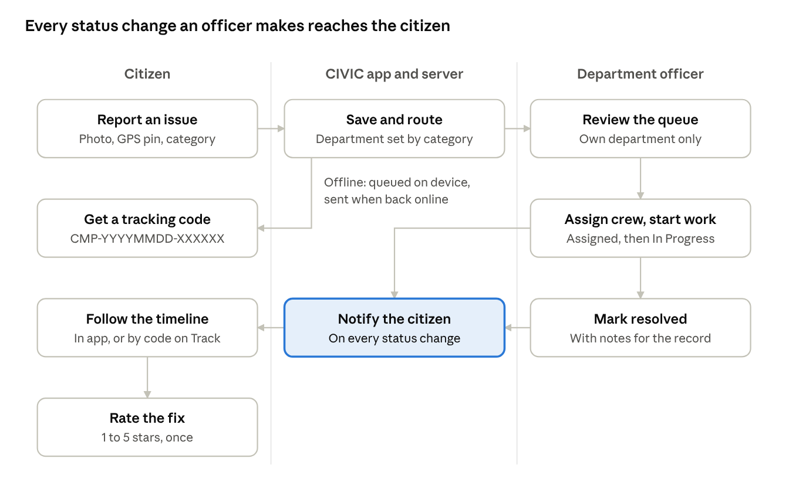
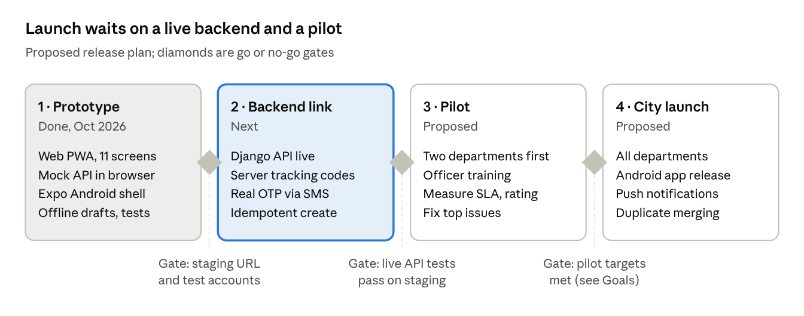

# CIVIC — Product Requirements Document (PRD)

> Exported from the live Claude Doc on 2026-11-06: https://claude.ai/artifact/BYVQjkLbQW6yDbB2LhDJa7. Edit there, then re-export.

Nov 6, 2026 · @Sujit

## Overview

CIVIC lets residents of Gunupur (Rayagada district, Odisha) report civic problems from a phone, sends each one to the right municipal department, and shows its progress until it is fixed. It is the citizen front end of CivicSetu, a Django-based grievance platform.

**Problem.** Residents report potholes, garbage, water leaks and broken streetlights by phone or in person. They get no reference number, no status, and no idea which department owns the issue. Officers receive unstructured complaints with no photo or exact location.

**Product.** A mobile-first web app (installable as a PWA) plus an Android shell built with Expo. A citizen files a complaint with a photo, a GPS pin and a category, and gets a tracking code such as `CMP-20261001-K8P9M1`. Officers see their department's queue and update status. The citizen sees every change on a timeline.

**Vision.** Every civic issue in Gunupur has an owner, a status and a public record, and residents trust that reporting leads to action.

**Current state (November 2026).** The web prototype runs fully in the browser on a mock API adapter backed by localStorage. The Django API contract is verified in source but not yet connected live.

## Goals, non-goals and success metrics

The first release succeeds if citizens can file and follow a complaint without help, and every complaint reaches a named department.

**Goals**

1. File a complaint with photo, location and category in under 60 seconds.
2. Route every complaint to a department automatically from its category.
3. Give every complaint a tracking code anyone can look up without logging in.
4. Show status changes on a timeline and as notifications.
5. Keep working on poor networks: queue reports offline and send them when the connection returns.

**Non-goals for v1**

- AI classification of complaints (removed from v1 to cut submission latency).
- A full officer back-office: v1 officers can view their queue and change status only.
- Payments, property tax or other municipal services.
- Coverage beyond Gunupur municipality.

**Success metrics.** Targets below are proposed; no baseline exists yet.

| Metric | Definition | Proposed target |
| --- | --- | --- |
| Time to file | Open Report screen to tracking code shown | Median under 60 s |
| Routing coverage | Complaints with a department on creation | 100% |
| Resolution rate | Complaints Resolved within 30 days | 70% |
| Citizen satisfaction | Mean feedback rating on resolved complaints | 4.0 of 5 |
| Offline recovery | Queued reports that reach the server | 99% |
| Repeat use | Citizens who file a second complaint within 90 days | 30% |

## User personas

Four personas map to the three roles in the code: `citizen`, `guest` and `authority`.

| Persona | Who they are | What they need | How they sign in | What they can see |
| --- | --- | --- | --- | --- |
| Registered citizen | Gunupur resident with a smartphone, often on a 3G/4G connection | Report fast, follow progress, get told when it is fixed | Mobile number + 4-digit OTP, or Face ID / fingerprint | Only their own complaints, matched by user ID or phone |
| Guest citizen | Resident who will not register, or a one-off reporter | Report without an account and still track it | No sign-in (guest session) | Only complaints filed from this browser, up to the last 10 tracking codes |
| Department officer | Field inspector or engineer in PWD, PHED, Sanitation or Electrical wing | See their department's queue and log progress | Official email or officer ID + password, choosing a department | All complaints routed to their department |
| Municipal administrator | Grievance cell head overseeing all departments | See everything, spot backlogs | Authority login with department set to "All" | All complaints across departments |

## Key user journeys

One complaint passes through three hands: the citizen reports it, CIVIC routes it, and an officer works it, with the citizen told at every step.

**Track without signing in.** Anyone with a tracking code can open Track, enter the code and see the status, department, locality and timeline. Personal details are never shown.

**Feedback.** Once a complaint is Resolved, its owner can rate the fix once. Low ratings are the main signal that a complaint was closed without being fixed.

## Functional requirements

26 requirements across 8 areas, 15 of them P0. The prototype has 14 built, but every server-side behaviour (sign-in, storage, sync, officer actions) is mocked in the browser.

| ID | Area | Requirement | Priority | Prototype status |
| --- | --- | --- | --- | --- |
| FR-01 | Account | Citizen signs in with mobile number and a 4-digit OTP | P0 | Mocked |
| FR-02 | Account | Citizen can report as a guest with no account | P0 | Built |
| FR-03 | Account | Officer signs in with official email or officer ID, password and department | P0 | Mocked |
| FR-04 | Account | Citizen registers with name, phone and optional email | P1 | Mocked |
| FR-05 | Account | Sessions use access and refresh tokens; logout revokes the refresh token | P0 | Mocked |
| FR-06 | Account | Returning users sign in with Face ID or fingerprint (WebAuthn passkey) | P2 | Mocked |
| FR-07 | Report | Form takes a title, a description and one of 9 categories | P0 | Built |
| FR-08 | Report | One photo from camera or gallery, up to 8 MB; Android uses the native camera | P0 | Built |
| FR-09 | Report | Location from GPS, map pin or typed address, with an IP-based fallback | P0 | Built |
| FR-10 | Report | Category sets the department and default priority automatically | P0 | Built |
| FR-11 | Report | Server issues a tracking code in the form CMP-YYYYMMDD-XXXXXX | P0 | Partial |
| FR-12 | Report | An unsent form auto-saves as a draft and can be resumed | P1 | Built |
| FR-13 | Report | Nearby duplicates are detected and merged, raising the report count | P1 | Not built |
| FR-14 | Track | My Grievances lists only the signed-in user's complaints | P0 | Built |
| FR-15 | Track | Details show a timeline: Pending, Routed, Assigned, In Progress, Resolved, Closed | P0 | Built |
| FR-16 | Track | Anyone can look up a tracking code; the result shows locality only, never coordinates or contact data | P0 | Built |
| FR-17 | Track | Share the app link by QR code, copy link or the phone's share sheet | P2 | Built |
| FR-18 | Notify | Notification list with unread count; mark one or all as read | P0 | Partial |
| FR-19 | Notify | Push notification on every status change | P1 | Mocked |
| FR-20 | Feedback | Citizen rates a Resolved complaint 1 to 5 stars with an optional comment, once | P1 | Built |
| FR-21 | Officer | Officer sees the department queue and updates status with notes | P0 | Mocked |
| FR-22 | Map | Map shows complaints within an adjustable radius (default 3 km) or by ward | P1 | Built |
| FR-23 | Offline | Reports filed offline are queued and sent when the network returns | P0 | Mocked |
| FR-24 | Platform | Installable PWA with a service worker and app manifest | P1 | Built |
| FR-25 | Platform | Light and dark themes, remembered per user | P2 | Built |
| FR-26 | Platform | Android app wraps the website and adds native camera access | P1 | Partial |

Mocked means the screen works but data never leaves the browser. Gaps to close before launch: FR-11 codes are generated in the browser; FR-18 the app calls `/notifications/read-all` but the adapter only handles `/notifications/mark-all-read`, so mark-all is not stored; FR-23 the queue marks reports as synced without sending them; FR-22 the map screen exists, but no button in the app opens it.

## Non-functional requirements

The app must stay fast and usable on a mid-range Android phone on a weak 3G connection, and must never expose a citizen's exact location or phone number publicly.

| Area | Requirement | Measure |
| --- | --- | --- |
| Performance | Home screen interactive quickly on 3G | Under 3 s on a mid-range Android phone |
| Performance | Location fix never blocks the form | GPS timeout 1.8 s, reverse geocoding 2 s, then fall back to IP location or Gunupur centre |
| Performance | API responses for list and detail | p95 under 500 ms at the server |
| Offline | Reports filed with no network are kept and sent later | No report lost; retry up to 5 times |
| Availability | Citizen API and tracking page | 99.5% monthly |
| Security | Tokens stored outside page-readable storage | Expo SecureStore on Android; httpOnly cookies or equivalent on web |
| Security | All traffic encrypted | HTTPS only, HSTS on |
| Privacy | Public tracking hides personal data | Locality only; no name, phone or coordinates |
| Privacy | Citizens see only their own complaints | Enforced by the server, not the client |
| Accessibility | Usable with screen readers and large text | WCAG 2.1 AA; every icon button has a label |
| Platforms | Works on the browsers and devices residents use | Chrome Android 10+, Safari iOS 15+, desktop Chrome/Edge/Firefox; Android app via Expo SDK 54 |
| Images | Uploads stay small enough for 3G | 8 MB client limit; server accepts JPEG, PNG, WEBP up to 5 MB each |
| Localisation | Language support | English at launch; Odia and Hindi to be decided |

The 8 MB client limit is larger than the 5 MB the Django serializer accepts, so photos between 5 and 8 MB will be rejected by the server until the client compresses or lowers the limit.

## Scope and release plan

Release 1 covers the citizen journey end to end plus a minimal officer view. It ships after the Django API is live and a pilot meets its targets.

**In scope for release 1**

- Citizen and guest reporting, tracking, notifications and feedback (FR-01 to FR-20, except duplicate merging FR-13)
- Officer queue and status updates (FR-21)
- Nearby-complaints map (FR-22), offline queue (FR-23), PWA and Android shell (FR-24 to FR-26)

**Out of scope**

- AI classification and suggested actions
- Officer analytics dashboards and SLA reporting
- Payments, property tax and other municipal services
- Municipalities other than Gunupur

The prototype phases finished in October 2026; dates for later phases are not set yet.

## Risks, dependencies and open questions

The biggest risk is that the prototype looks finished but stores nothing on a server; launch depends on connecting the Django API.

**Risks**

| Risk | Impact | Mitigation |
| --- | --- | --- |
| Mock adapter mistaken for a working backend | Complaints never reach officers | Wire `VITE_CIVICSETU_API_URL` to Django; remove the mock from production builds |
| No idempotency key on complaint creation | Offline retries can create duplicates | Add a client-generated request ID that the server deduplicates |
| Officers do not update status | Citizens lose trust | Officer training; SLA alerts on complaints stuck in one status |
| OTP cost and delivery on rural networks | Citizens cannot sign in | Keep guest reporting; choose an SMS provider with Odisha coverage |
| Photos with location data | Privacy exposure | Strip EXIF before upload; serve public images without metadata |

**Dependencies**

- CivicSetu Django API reachable over HTTPS, with a staging URL and test accounts.
- SMS gateway for OTP.
- Department master data and officer accounts from Gunupur Municipality.
- Expo/EAS account and signing keys for the Android build.

**Open questions**

- [ ] Do citizens sign in by phone + OTP (this app) or email + password (current Django API)?
- [ ] Which authority closes a complaint, and can a citizen reopen it?
- [ ] Should Odia and Hindi ship at launch?
- [ ] What resolution SLA does each department commit to?
- [ ] Is the public tracking page indexed by search engines or link-only?
