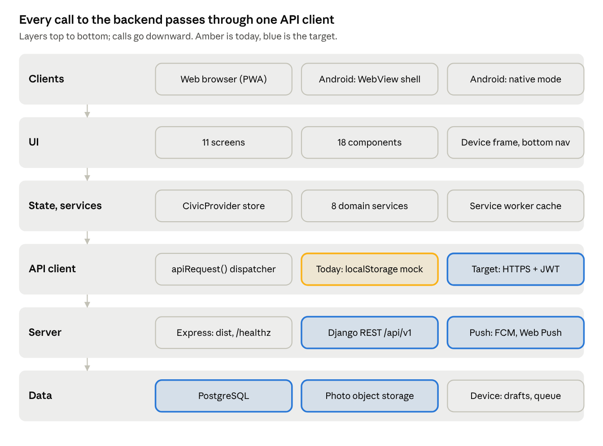
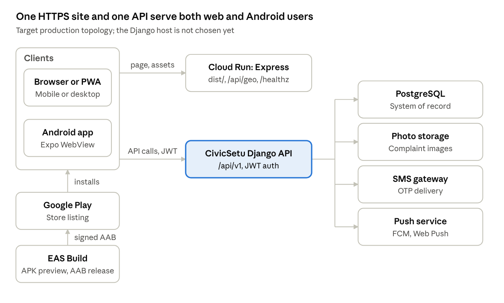

# CIVIC — System Architecture

> Exported from the live Claude Doc on 2026-11-06: https://claude.ai/artifact/VpEL1EDDoRHoJ5q79kd56r. Edit there, then re-export.

Nov 6, 2026 · @Sujit

## Architecture overview and principles

CIVIC is a thin client architecture: a React single-page app (also wrapped as an Android app) talks to one authoritative backend, the CivicSetu Django REST API on PostgreSQL. Today the client runs against a mock adapter in the browser; the target replaces that adapter with HTTPS calls to Django.

**Parts of the system**

- **Web app (PWA)** — React 19, Vite 8, Tailwind 4, TypeScript. Installable, with a service worker for offline use.
- **Web server** — Express 4 (`server.js`) serves the built app, two geo query endpoints and a health check, aimed at Google Cloud Run.
- **Android app** — Expo SDK 54. Default mode wraps the website in a WebView and adds a native camera; an alternative native mode talks to Django directly.
- **CivicSetu backend** — Django REST API with JWT auth, in a sibling repository. It owns users, complaints, departments, timelines, notifications and feedback.

**Principles**

1. **The server is the source of truth.** Only Django creates complaint IDs and tracking codes; clients never invent authoritative records.
2. **Privacy by default.** Citizens see only their own complaints; public tracking shows locality, never coordinates or contact details.
3. **Offline-tolerant, honest sync.** Reports survive network loss, but the app never claims a report was sent until the server confirms it.
4. **One codebase for web and Android.** The WebView shell reuses the website; native code is limited to what the web cannot do (camera, secure storage).
5. **Replaceable adapters.** All network access goes through one API module, so swapping mock for real backend touches one file.

## Layered architecture

Six layers, each calling only the one below. The API client layer is the seam where the prototype's mock is swapped for the real backend.

The WebView shell loads the same web app, so it passes through every web layer. Android native mode skips the web layers and calls Django through its own typed client in `mobile/src/services/api.ts`.

## Technology stack

Versions are taken from `package.json`, `mobile/package.json` and the existing docs in `docs/`.

| Layer | Technology | Version | Used for |
| --- | --- | --- | --- |
| Web UI | React + React DOM | 19.0 | Screens and components |
| Web build | Vite + @vitejs/plugin-react | 8.3 / 6.1 | Dev server on port 3000, production bundle in `dist/` |
| Styling | Tailwind CSS (Vite plugin) | 4.3 | Utility classes, light and dark themes |
| Language | TypeScript | 7.0 | Typed contracts in `src/types` |
| Icons and effects | lucide-react, canvas-confetti | 0.546, 1.9 | Icons; success animation |
| Offline | Service worker (`public/sw.js`), Web App Manifest | cache `civic-cache-v1` | App-shell caching, background sync tag |
| Web server | Node.js + Express | Node 24 locally, Express 4.21 | Serves `dist/`, `/api/geo/*`, `/healthz` |
| Android shell | Expo + React Native | SDK 54, RN 0.81.5 | WebView wrapper and native screens |
| Android modules | react-native-webview, expo-camera, expo-secure-store, expo-sqlite, NetInfo | 13.15, 17, 15, 16, 11.4 | Web wrapper, camera, token storage, drafts, connectivity |
| Android navigation | React Navigation (bottom tabs, native stack) | 7 | Native mode screens |
| Tests | Vitest | 3.2 | Mobile API and draft-sync unit tests |
| Backend | Django REST API with JWT (access + refresh, refresh blacklist) | — | Auth, complaints, departments, notifications, feedback |
| Database | PostgreSQL | — | System of record behind Django |
| Build and release | EAS Build | — | Android APK (preview) and AAB (production) |
| External APIs | BigDataCloud reverse geocoding, ipapi.co, Google Fonts | — | Address from GPS, IP location fallback, fonts |

Backend versions are not recorded in this repository; they live in the sibling Django project.

## Deployment topology

Three environments: local development, a staging backend still to be set up, and production. In production the web app and the Android app load the same HTTPS site and call the same Django API.

| Environment | Web app | Backend | Android |
| --- | --- | --- | --- |
| Local dev | `npm run dev`: Vite on port 3000, bound to 0.0.0.0, hot reload unless `DISABLE_HMR=true` | Mock adapter in the browser; optional local Django at `http://10.0.2.2:8000` for the emulator | `npx expo start`; WebView points at the dev machine's LAN IP |
| Staging | Not set up | Needed: non-production Django with test accounts | EAS `preview` profile builds an internal APK |
| Production | `npm run build`, then `npm start` (`server.js`, Express on `PORT`, default 3000) on Cloud Run | CivicSetu Django on HTTPS (host to be chosen) | EAS `production` profile builds an AAB for Google Play |

The Android package ID is `com.civicsetu.mobile`, version 0.1.0, version code 1.

## Runtime views

Two paths matter at runtime: a normal online request, and a report filed with no network. Step-by-step sequence diagrams for each are in the LLD.

**Online request (target)**

1. A screen calls an action on the `CivicProvider` store, for example `submitComplaint(input)`.
2. The store calls a domain service (`complaintService.createComplaint`).
3. The service calls `apiRequest()`, which adds the Bearer access token and sends HTTPS to Django.
4. Django checks the JWT and the user's role, validates the input, writes to PostgreSQL and returns the saved record with its tracking code.
5. On 401, the client refreshes the token once with `POST /auth/refresh/` and retries; on a second 401 it signs the user out.
6. The store updates React state; the screen re-renders and shows the Success screen with the server's tracking code.

**Offline report**

1. `complaintService.createComplaint` sees `navigator.onLine === false`, or the request fails with a network error.
2. `offlineSyncService.enqueueComplaint` saves the input to the queue (localStorage key `civic_offline_sync_queue`) and shows a local copy flagged `isOfflineQueued`.
3. It asks the service worker for a background sync with tag `civic-offline-sync`.
4. When the browser fires `online`, the background sync event, or the 15-second timer finds pending items, `processQueue()` runs.
5. Target: each item is sent to Django with its idempotency key. Success replaces the local copy with the server record; a network error leaves it queued (up to 5 tries); a validation error marks it failed for the citizen to fix.

Today step 5 only marks items as synced locally; it does not call any server.

## Cross-cutting concerns

Security and observability are the weakest areas today: web tokens sit in localStorage and there is no error reporting beyond the browser console.

| Concern | Today | Target |
| --- | --- | --- |
| Authentication | Mock tokens issued in the browser; any 4-digit OTP accepted | Django JWT: short-lived access token, refresh token rotated and blacklisted on logout |
| Token storage | Web: localStorage key `civic_secure_tokens`. Android native mode: Expo SecureStore | Web: httpOnly, Secure, SameSite cookies or in-memory access token. Android: SecureStore |
| Authorization | Role filtering done in the browser | Enforced by Django per request: owner, department authority or admin |
| Transport | Dev over HTTP; WebView default URL is an HTTP LAN address | HTTPS everywhere with HSTS; WebView loads only the HTTPS production origin |
| WebView bridge | Accepts camera requests only from the configured origin; other links open in the system browser | Same, plus a strict origin allow-list in production builds |
| Privacy | Public tracking strips name, phone and coordinates | Same, enforced by a server-side public serializer; EXIF stripped from photos |
| Observability | `console.warn` only; `/healthz` on the Express server | Structured JSON logs, client and server error tracking (for example Sentry), uptime checks on `/healthz` and the Django health route |
| PWA | Manifest (standalone, portrait); service worker caches the app shell; icon is a 64 px favicon only | Add 192 px and 512 px PNG icons so browsers offer install; version the cache per release |
| Configuration | `VITE_CIVICSETU_API_URL` (read but unused), `EXPO_PUBLIC_CIVICSETU_API_URL`, `EXPO_PUBLIC_CIVICSETU_WEB_URL`, `EXPO_PUBLIC_CIVICSETU_APP_MODE`, `PORT`, `DISABLE_HMR` | Same names, set per environment; no secrets in client builds |
| Accessibility | Icon buttons carry `aria-label`; dark mode supported | WCAG 2.1 AA audit before launch |

## Current vs target architecture

The move to the target is mostly one change: replace the browser-side mock adapter with an HTTP client for the Django API, then delete what the mock was standing in for.

| Component | Current (prototype) | Target |
| --- | --- | --- |
| API layer | `apiRequest()` routes calls to `CivicSetuApiAdapter`, which reads and writes localStorage | `apiRequest()` calls `${VITE_CIVICSETU_API_URL}/api/v1/...` with a Bearer token, 15 s timeout, typed errors |
| Data store | localStorage keys `civic_civicsetu_complaints_db`, `civic_civicsetu_notifs_db`, seeded with 4 Gunupur complaints | PostgreSQL behind Django; browser keeps only session, draft and offline queue |
| Tracking codes | Generated in the browser | Generated by Django on create |
| Offline sync | Queue marked synced without a server call | Queue sends to `POST /complaints/create/` with an idempotency key; keeps `UNKNOWN` state on ambiguous failures, as the Android native mode already does |
| Geo queries | Mongo-style `$near` simulated in the browser (`mongoGeospatial.ts`) and in Express over 4 in-memory records | One server-side nearby query on PostgreSQL with a spatial index |
| Officer actions | Status update written to localStorage | Django endpoint with authority permission and audit trail |
| Notifications | Written to localStorage; push shown as an in-app toast | Django notifications API; push via Firebase Cloud Messaging for Android and Web Push for the PWA |
| Android | WebView shell pointing at a LAN URL | WebView shell pointing at the HTTPS production site, published to Google Play |

**Migration order**

1. Stand up staging Django with test accounts; point `VITE_CIVICSETU_API_URL` at it.
2. Port the typed client from `mobile/src/services/api.ts` into the web app and map Django's snake\_case fields to the web types.
3. Switch auth, complaints, tracking, notifications and profile services to the real client one at a time.
4. Rework offline sync to send to the server, with an idempotency key agreed with the backend team.
5. Move nearby-complaint queries to the backend; retire `server.js` geo endpoints and the browser geo engine.
6. Remove the mock adapter and seed data from production builds.
