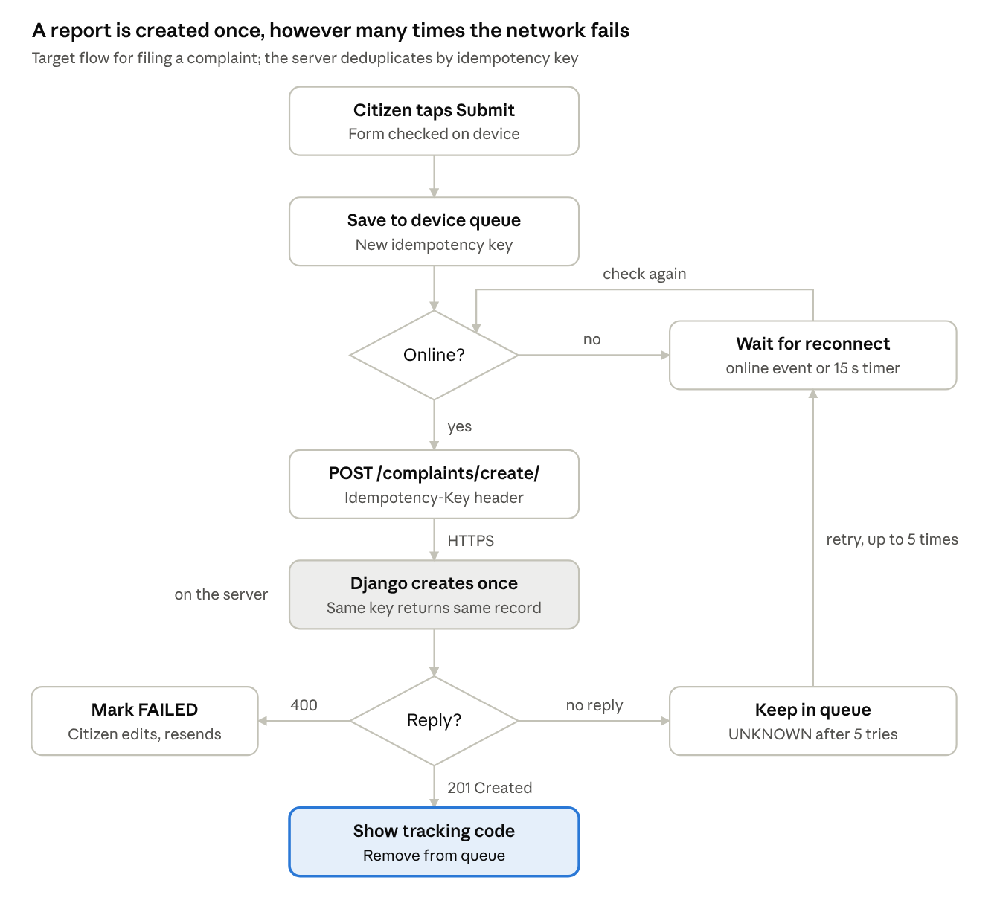

# CIVIC — System Design

> Exported from the live Claude Doc on 2026-11-06: https://claude.ai/artifact/B9y4iMec9shiaLff9o9mUw. Edit there, then re-export.

Nov 6, 2026 · @Sujit

## Requirements recap

CIVIC is a small-scale, write-light, read-heavy system whose hard problems are unreliable networks and privacy, not raw load. Full requirements are in [CIVIC — Product Requirements Document (PRD)](PRD.md).

**Functional drivers**

- Create a complaint with photo and location; the server returns an ID and tracking code.
- List a user's own complaints; list a department's queue for officers.
- Look up any complaint by tracking code, publicly, with personal data removed.
- Change status with a timeline entry and a notification to the reporter.
- Find complaints near a point, within a radius.
- Accept one rating per resolved complaint.

**Non-functional drivers**

- Work on 3G and survive going offline mid-report without losing it or creating duplicates.
- Scope every read to the caller's role on the server.
- p95 API latency under 500 ms; 99.5% monthly availability.
- Keep data in India and handle it under the DPDP Act, 2023.

## Capacity estimates

Even at ten times the expected load, CIVIC needs one small database and one app server. Photos are 99% of storage and the main cost on slow networks.

These are planning assumptions, not measurements; replace them with pilot data.

| Quantity | Assumption or calculation | Year 1 | 10× headroom |
| --- | --- | --- | --- |
| Residents served | Approximate; confirm with the municipality | 30,000 | 300,000 |
| Active reporters | 20% of residents | 6,000 | 60,000 |
| Complaints | 2 per active reporter per year | 12,000 / year (≈ 33 / day) | 120,000 / year |
| Peak write rate | 10× average day, 20% of a day in one hour | ≈ 66 / hour (0.02 / s) | ≈ 0.2 / s |
| API reads | 6,000 users × 1 session a week × 5 calls, plus 20 views per complaint | ≈ 5,000 / day; peak under 10 / s | under 100 / s |
| Status changes | 4 per complaint, each a timeline row and a notification | 48,000 / year | 480,000 / year |
| Record storage | ≈ 5 KB per complaint with timeline and notifications | ≈ 60 MB / year | ≈ 600 MB / year |
| Photo storage | 1 photo per complaint, 1.5 MB after client compression | ≈ 18 GB / year | ≈ 180 GB / year |
| OTP SMS | 4 sign-ins per active user per year | 24,000 / year | 240,000 / year |

Without client-side compression, photos up to 5 MB each would push year-1 storage to about 60 GB and make uploads slow on 3G. Compression to about 1,600 px on the long edge is the single most useful capacity measure.

## API design

REST over HTTPS under `/api/v1`, JSON in snake\_case, JWT Bearer auth. 14 endpoints are verified in the Django source (as of 14 Oct 2026), 2 appear in its schema but are unverified, and 5 must be added for features the web app already has.

| Method | Path | Auth | Purpose | Status |
| --- | --- | --- | --- | --- |
| POST | `/auth/login/` | Public | Email + password → user and token pair | Verified in source |
| POST | `/auth/register/` | Public | Email, password, full name, optional phone → tokens | Verified in source |
| POST | `/auth/refresh/` | Refresh token | New token pair | Verified in source |
| POST | `/auth/logout/` | JWT | Blacklist the refresh token | Verified in source |
| GET | `/auth/me/` | JWT | Current user | Verified in source |
| POST | `/auth/otp/request/` | Public, rate-limited | Send a 4-digit OTP to a phone | Needed |
| POST | `/auth/otp/verify/` | Public, rate-limited | Phone + OTP → tokens | Needed |
| GET | `/complaints/?page=N` | JWT | Paginated list, scoped by role | Verified in source |
| POST | `/complaints/create/` | Public or JWT | Create; JSON or multipart with `images` | Verified in source |
| GET | `/complaints/{public_id}/` | JWT, owner or authority | Full complaint | Verified in source |
| GET | `/complaints/{public_id}/timeline/` | JWT, owner or authority | Status history | Verified in source |
| GET | `/complaints/track/{tracking_code}/` | Public | Reduced public record | Verified in source |
| POST | `/complaints/{public_id}/status/` | JWT, department authority | New status + remarks | Needed |
| POST | `/complaints/{public_id}/feedback/` | JWT, owner, after Resolved | Rating 1–5 + comment, once | In schema |
| GET | `/complaints/nearby/?lat=&lng=&radius_m=` | Public | Reduced records within radius, nearest first | Needed |
| GET | `/notifications/` | JWT | `{unread_count, notifications}` | Verified in source |
| POST | `/notifications/{public_id}/mark-read/` | JWT, recipient | Mark one read | Verified in source |
| POST | `/notifications/mark-all-read/` | JWT | Mark all read | Needed |
| GET | `/users/profile/citizen/` | JWT | Citizen profile | Verified in source |
| PATCH | `/users/profile/update/` | JWT | Update full name, phone, bio, address | Verified in source |
| GET | `/departments/` | Public | Department list for routing and filters | In schema |

**Create complaint** (multipart when a photo is attached; send an `Idempotency-Key` header, proposed):

```text
POST /api/v1/complaints/create/
Idempotency-Key: 7f9c2e1a-5b0d-4c3e-9a51-2d8b6e4f1c07

title=Deep pothole at Main Market
description=Two-wheelers losing balance near the crossing
category=ROADS
priority=HIGH
location_address=Main Market Road, Old Town, Gunupur
latitude=19.0805
longitude=83.8166
images=<file: pothole.jpg, image/jpeg, ≤ 5 MB>
```

**Response 201** (shape from `mobile/src/services/api.ts`):

```json
{
  "public_id": "c_01J9Z...",
  "tracking_code": "CMP-20261001-K8P9M1",
  "title": "Deep pothole at Main Market",
  "status": "PENDING",
  "category": "ROADS",
  "priority": "HIGH",
  "location_address": "Main Market Road, Old Town, Gunupur",
  "latitude": "19.0805",
  "longitude": "83.8166",
  "images": [{"public_id": "img_...", "image": "https://.../pothole.jpg", "caption": "", "uploaded_at": "2026-10-01T09:12:00Z"}],
  "assigned_authority_name": null,
  "created_at": "2026-10-01T09:12:00Z",
  "updated_at": "2026-10-01T09:12:00Z"
}
```

**Conventions.** Lists are paginated as `{count, next, previous, results}`. Errors use Django REST Framework's `{field: [messages]}` shape with the right HTTP status. Clients address records by `public_id` and `tracking_code`, never by database ID. Category and status codes shown above are illustrative; the canonical values come from the Django enums.

## Core flows

Filing is the one flow with real failure handling; tracking and notifications are simple reads and writes once filing is safe.

**Filing a complaint**



Every report goes through the device queue, online or not, so there is one code path. The server stores each idempotency key with the complaint it created, so a retry after a lost reply returns the same tracking code instead of a duplicate.

**Tracking a complaint**

1. Anyone enters a code on the Track screen; the client upper-cases and trims it.
2. `GET /complaints/track/{code}/` returns the public view: title, category, department, status, locality, report count, timeline.
3. If the complaint is Resolved and has no feedback, the owner sees the rating prompt.

**Status change and notification**

1. An officer sets a new status with remarks.
2. Django checks that the complaint belongs to the officer's department, updates it, and appends a history row.
3. In the same transaction it creates a notification for the reporter.
4. After commit, a push message goes out; the app's notification list and unread badge refresh when opened.

## Scaling, caching and geospatial queries

At the expected load one app server and one database are enough; the design keeps the server stateless so it can scale out if usage grows tenfold.

**Scaling**

- Stateless app servers: JWT auth, no server sessions, so Cloud Run (web) and the Django host can add instances behind a load balancer.
- One PostgreSQL primary; add a read replica only if list and tracking reads exceed what one instance serves.
- Photos go to object storage, not the database, and are served through a CDN.

**Caching**

| What | Where | Policy |
| --- | --- | --- |
| App shell (`/`, `index.html`, manifest) | Service worker cache `civic-cache-v1` | Precached on install; stale-while-revalidate |
| JS, CSS, fonts | Service worker + CDN | Hashed file names, cache for a year |
| API GETs | Service worker | Network first, cached copy only when offline |
| Public tracking result | CDN or server cache | 60 s; invalidate on status change |
| Department list | Client memory | Load once per session |
| Complaint photos | CDN | Long cache; new photo gets a new URL |

**Geospatial queries**

The map asks: which complaints lie within R metres of a point, nearest first? The prototype answers in the browser with a haversine scan written in MongoDB syntax (`$near`, `$geoWithin` with `$centerSphere`), and `server.js` does the same over four in-memory records.

Target: one backend query. With PostgreSQL + PostGIS, store `location geography(Point, 4326)`, index it with GiST, and query:

```sql
SELECT public_id, tracking_code, title, status, category,
       ST_Distance(location, ST_MakePoint(:lng, :lat)::geography) AS distance_m
FROM complaints
WHERE ST_DWithin(location, ST_MakePoint(:lng, :lat)::geography, :radius_m)
ORDER BY distance_m
LIMIT 100;
```

If MongoDB is chosen instead, the same query is `$near` with `$maxDistance` on a `2dsphere` index, which is what the prototype imitates. The default radius is 3 km; results return locality only, never the exact point, to anonymous callers.

## Reliability, security and privacy

The two failure modes that would hurt trust most are a lost report and a leaked phone number; the design guards against both on the server, not just in the app.

**Reliability**

| Failure | Design response |
| --- | --- |
| Network drops while submitting | Report stays in the device queue with an idempotency key; retried on reconnect, up to 5 times |
| Request reaches the server but the reply is lost | Server stores the idempotency key with the created complaint and returns the same record on retry; no duplicate |
| Timeout with unknown outcome | Client marks the item `UNKNOWN` and asks the user to check My Grievances before resending, as Android native mode already does |
| Location services slow or denied | GPS 1.8 s timeout, reverse geocoding 2 s, then IP location, then Gunupur centre; the user can move the pin |
| Django or database down | Clients show an error and keep queued reports; health checks on `/healthz` and the Django health route alert on-call |
| Bad deploy | Cloud Run keeps the previous revision for instant rollback; database migrations are backward compatible for one release |
| Data loss | Daily PostgreSQL backups plus point-in-time recovery; object storage versioning for photos |

**Security**

- JWT access tokens of 15 to 60 minutes; refresh tokens rotated and blacklisted on logout.
- Web tokens out of localStorage: httpOnly, Secure, SameSite cookies, or access token in memory only.
- Every query filtered by role on the server: owner, department authority or admin.
- OTP: 4 digits, 5-minute expiry, at most 5 attempts per phone per hour, and rate limits per IP.
- Uploads: JPEG, PNG or WEBP only, 5 MB maximum, content-type sniffed, stored outside the web root.
- Android WebView loads only the production HTTPS origin and accepts bridge messages only from it.

**Privacy**

- Public tracking and nearby results return locality, category, status and timeline only; no name, phone, email or coordinates.
- EXIF metadata, including GPS, stripped from photos before they are stored.
- Guest reports collect no personal data.
- Data hosted in an Indian region; retention and deletion rules set under the DPDP Act, 2023.

## Trade-offs and future improvements

The design favours simplicity and one source of truth over features that the current scale does not need.

| Choice | Chosen | Rejected | Reason |
| --- | --- | --- | --- |
| Database | PostgreSQL (+ PostGIS for nearby search) | MongoDB with 2dsphere | Django already uses PostgreSQL; relational data (users, departments, history) fits tables; PostGIS covers the geo need |
| Routing | Category → department lookup table | AI classification | Instant and predictable; AI can return later as a suggestion the citizen confirms |
| Status updates to clients | Pull on screen open + push notification | WebSockets | Status changes a few times per complaint over days; live sockets add cost for no visible gain |
| Offline sync | Client queue + idempotency key | Background sync only | Background Sync API is missing on iOS Safari; the in-app timer and `online` event cover it |
| Android app | WebView shell + native camera | Full native rewrite | One codebase; native mode stays as a fallback if WebView performance is poor |
| Tracking code | `CMP-YYYYMMDD-XXXXXX`, 6 characters from a 32-character alphabet without 0, O, 1, I | Sequential numbers | About 1 billion codes per day; hard to guess, easy to read aloud |

**Future improvements**

- Duplicate detection: on create, look for open complaints of the same category within 50 m and offer to join them, raising the report count.
- SLA engine: per-department deadlines, overdue flags and escalation to the grievance cell.
- Officer web console with bulk actions and ward filters.
- AI suggestions for category and department, shown to the citizen before submit.
- Odia and Hindi translations.
- Analytics: complaints by ward and category, median resolution time, satisfaction trend.
